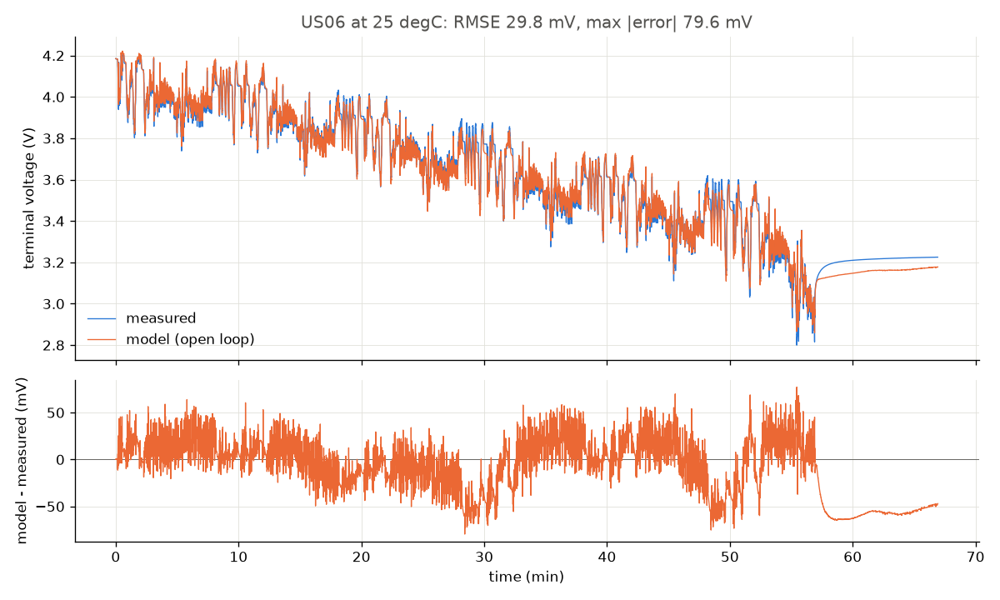
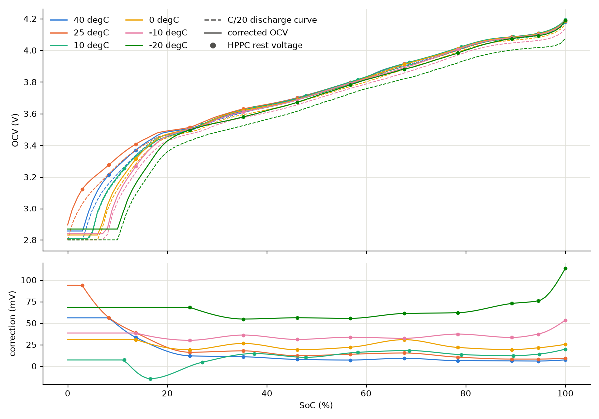
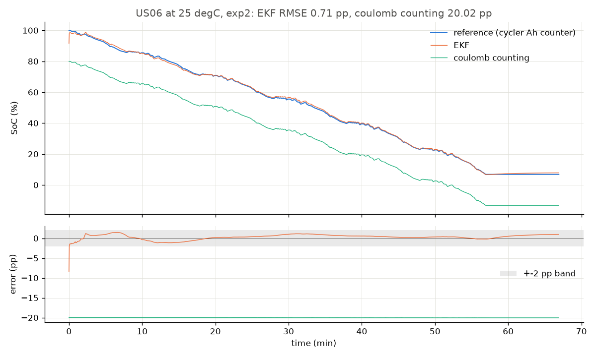
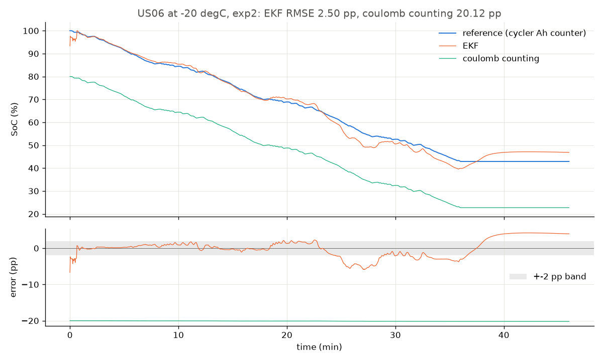
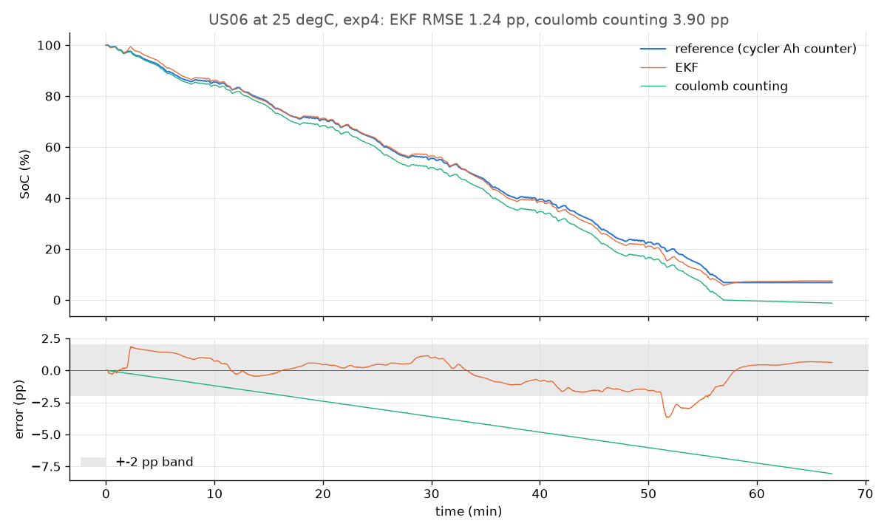
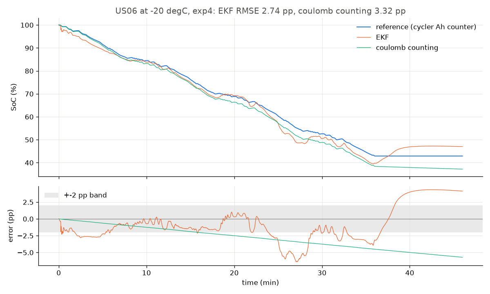
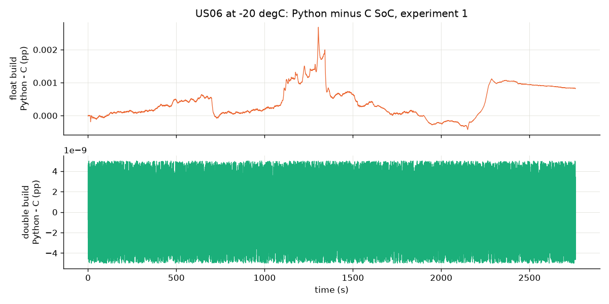

# EKF SoC Estimator

State-of-charge (SoC) estimation for a Li-ion cell with a 2RC equivalent-circuit model and an Extended Kalman Filter (EKF). A Python reference is fitted and validated offline on the public LG 18650HG2 dataset at all six of its temperatures. The same filter is ported to C99 for embedded targets, and the port is checked against the Python reference run by run. Every result number in this README is copied from a file in `results/` by `python/update_readme.py`.

## Claims

1. **The EKF recovers from a wrong initial SoC and keeps a current-sensor offset bounded, where plain coulomb counting does not. This holds in nearly every run at 40, 25, 10 and 0 degC. At -10 and -20 degC it holds only in part: in many cold runs the error does not settle inside the band before the end of the run ("not reached"), and some cold runs end several pp off.**
   Evidence: the convergence tables of experiments 2 and 3 (their `reached` rows count the runs per temperature) and the end-of-window errors of experiment 4, where coulomb counting drifts with the offset and the EKF does not.
2. **The float32 C port reproduces the Python reference to within 0.1 pp of SoC.**
   Evidence: `results/equivalence.md` runs the C filter and the Python filter on every evaluation run and the tuning cycle and compares the SoC row by row; the worst case is in the [C port equivalence](#s3-c-port-equivalence) table.

## What it is

<p align="center"></p>

**Model.** The cell is an open-circuit voltage OCV(SoC, T) in series with an ohmic resistance R0 and two RC branches, a fast one (R1, C1) and a slow one (R2, C2). The current I is positive on discharge. Every parameter is a table over temperature and SoC, read with clamped bilinear interpolation. The OCV comes from the C/20 discharge, corrected onto the HPPC rest voltages; R0 and the RC branches come from the HPPC pulses and rests (`docs/decisions.md` 1.1, 1.2, 1.12).

**Filter.** The EKF state is x = [SoC, V1, V2]. The input is the measured current, the measurement is the terminal voltage, and the measured cell temperature selects the table values. Each sample runs a predict step and an update step. The noise settings were tuned once, on Mix 1 at 25 degC only, and frozen (`docs/decisions.md` 1.3, 1.15). When an update pushes SoC outside [0, 1], the whole state is projected onto the bound along the covariance, not truncated (`docs/decisions.md` 1.16).

**Equations.** The full set, with conventions and symbols, is in [`docs/model.md`](docs/model.md). In short:

- Eq. 1, RC branches (exact zero-order hold): `V_i(k) = a_i V_i(k-1) + R_i (1 - a_i) I(k-1)`, with `a_i = exp(-dt / tau_i)`.
- Eq. 2, terminal voltage: `V = OCV(SoC, T) - V1 - V2 - R0(SoC, T) I`.
- Eq. 3, coulomb counting: `SoC(k) = SoC(k-1) - I(k-1) dt / (3600 Q_ref)`, with coulombic efficiency 1.
- Eq. 4 and Eq. 5, the clamped bilinear table lookup and the dOCV/dSoC table.
- Eq. 6 and Eq. 7, predict: the state through Eq. 1 and Eq. 3, and `P- = F P F^T + Q`, with `Q = diag(q_soc, q_v, q_v) dt`.
- Eq. 8 and Eq. 9, the predicted voltage, the Jacobian `H = [dOCV/dSoC, -1, -1]`, the innovation variance and the gain.
- Eq. 10 and Eq. 11, the state update with the SoC limit and the Joseph-form covariance update.

**Reference SoC.** The reference is coulomb counting on the cycler's own Ah counter from the full charge at the start of each test. Q_ref is the 25 degC C/20 discharge capacity, one value for every temperature (`docs/decisions.md` 1.6, `docs/model.md` C13). The plain coulomb-counting baseline integrates the logged current instead, as a BMS would.

**C port.** `c/` holds a C99 library with the same equations in the same operation order. It uses no dynamic allocation, no mutable globals and no file I/O. `ekf_real_t` is `float` by default and `double` on request.

## Dataset

LG 18650HG2 Li-ion Battery Data, P. Kollmeyer, M. Naguib and M. Skells, McMaster University, Mendeley Data, version 2, DOI [10.17632/b5mj79w5w9.2](https://doi.org/10.17632/b5mj79w5w9.2), licence CC BY 4.0. A new LG HG2 cell (nominal 3 Ah) was tested in a thermal chamber at 40, 25, 10, 0, -10 and -20 degC.

What this project uses from it, at all six temperatures:

- the C/20 discharge, for the OCV table;
- the HPPC test, for R0, R1, tau1, R2 and tau2 and for the OCV correction;
- the drive cycles UDDS, HWFET, LA92, US06 and the eight random mixes of them (Mix 1 to Mix 8), for the open-loop model check and the EKF experiments;
- the 1C and C/20 capacity tests, to document capacity and ageing.

The evaluation set is 62 drive-cycle runs (`docs/decisions.md` 1.5). Mix 1 at 25 degC is the tuning cycle; it is reported and flagged, but it is not in the set. Left out: the 25 degC HWFET file (it holds no current), the 40 degC Mix 4 to 8 files (partial runs), the -10 degC Mix 4 file (a corrupt log) and the PausCycl files (short runs the dataset readme does not list as tests). Mix 3 has no file at 10 and 0 degC. Tables show `n/a` where a run does not exist. The campaign ran 25 degC first, then 40, 10, 0, -10 and -20 degC, so the cell aged between temperatures. The measured capacities per folder:

<!-- results:capacity:begin -->

**C/20 and 1C capacities per folder**

The two 1C columns are the folder's first and second 1C run in the order they ran (the readme puts the first before UDDS and the second before Mix 3). A folder with only one 1C file has it in the first-run column if it started before the folder's UDDS file, otherwise in the second-run column. *cell T* is the temperature the cell was actually at (min / max over the discharge). *C/20 charge* is the Ah put back by the charge part of the same C20DisCh file (highest counter after the discharge minus the counter at the end of the discharge); it is shown for comparison only.

| folder | C/20 discharge (Ah) | C/20 charge, same file (Ah) | charge / discharge | 1C first run (Ah) | first run: file, cell T (degC) | 1C second run (Ah) | second run: file, cell T (degC) |
|---|---|---|---|---|---|---|---|
| 25degC | 2.7807 | 2.9709 | 1.068 | 2.7264 | `551_Cap_1C_25degC_LGHG2`, 23.9 / 25.4 | 2.6928 | `552_Cap_1C_25degC_LGHG2`, 23.8 / 25.4 |
| 40degC | 2.6899 | 2.8668 | 1.066 | missing | no file | 2.5004 | `557_Cap_1C_40degC_LGHG2`, 1.3 / 30.7; **off-temperature**, not a 40 degC capacity |
| 10degC | 2.6488 | 2.6959 | 1.018 | 2.4851 | `571_Cap_1C`, 0.7 / 3.6; **off-temperature**, not a 10 degC capacity | 2.5465 | `576_Cap_1C_10degC_LGHG2`, 9.1 / 11.0 |
| 0degC | 2.5986 | 2.6869 | 1.034 | 2.4734 | `589_Cap_1C_10degC_LGHG2`, -0.6 / 2.2; named 10 degC, valid as 0 degC | missing | no file |
| n10degC | 2.5636 | 2.6018 | 1.015 | 2.2634 | `596_Cap_1C_n10degC_LGHG2`, -10.1 / -6.4 | 2.2319 | `602_Cap_1C_n10degC_LGHG2`, -10.0 / -6.5 |
| n20degC | 2.4948 | 2.4526 | 0.983 | 1.6713 | `610_Cap_1C_n20degC_LGHG2`, -19.8 / -15.4 | 1.6172 | `611_Cap_1C_n20degC_LGHG2`, -19.9 / -15.6 |

- 40degC: the only 1C file, `557_Cap_1C_40degC_LGHG2`, started after the folder's UDDS (`556_UDDS_40degC_LGHG2`), so it is the second run; the first run is missing. Before UDDS, where the readme puts the first 1C test, the data shows an unlogged discharge: `556_Charge2` opens at rest at 3.046 V, 65 min after 556_Charge1 ended at 4.193 V.
- `40degC/557_Cap_1C_40degC_LGHG2`: cell at 30.7 degC when the discharge starts, 1.3 / 30.7 degC min / max over it; folder 40 degC. Not a 40 degC capacity.
- `10degC/571_Cap_1C`: cell at 3.6 degC when the discharge starts, 0.7 / 3.6 degC min / max over it; folder 10 degC. Not a 10 degC capacity.
- 0degC: the only 1C file, `589_Cap_1C_10degC_LGHG2`, started before the folder's UDDS (`589_UDDS_0degC_LGHG2`), so it is the first run; the second run is missing.
- `0degC/589_Cap_1C_10degC_LGHG2`: cell at -0.6 degC when the discharge starts, -0.6 / 2.2 degC min / max over it; folder 0 degC. The name says 10 degC, but this is the 0 degC 1C test.
- The C/20, 0.5C and 2C tests all start their discharge within 5 degC of the folder temperature.

<!-- results:capacity:end -->

## How to run

Requirements: Python 3.12, CMake and a C99 compiler. `make arm` also needs `arm-none-eabi-gcc`, the release named in `results/c_footprint.md`. `make octave` needs GNU Octave 8 or later with `octave-cli` on PATH.

```sh
python3.12 -m venv .venv
.venv/bin/pip install -r requirements.txt
make data        # download the raw .mat files into data/raw/ and verify their sha256
make all         # every stage below, in order
```

| target | stage | what it does | writes |
|---|---|---|---|
| `make data` | | fetches the dataset file by file and checks each file against `data/checksums.sha256` | `data/raw/` (git-ignored) |
| `make inventory` | S0 | lists every file and measures the capacity tests | `results/data_inventory.md`, `results/capacity.md` |
| `make checks` | S0 | measures the dataset properties the docs cite | `results/data_checks.md` |
| `make fit` | S1 | fits the OCV and 2RC tables, runs the US06 open-loop check, generates the C tables | `results/params.*`, `results/model_fit.md`, `results/plots/s1/`, `c/src/ekf_params.c` |
| `make tune` | S2 | tunes the noise settings on the tuning cycle and freezes them; not part of `make all` | `results/tuning.md`, `results/ekf_config.json` |
| `make ekf` | S2 | runs the four experiments on the evaluation set and the tuning cycle | `results/ekf_results.csv`, `results/ekf_summary.md`, `results/plots/s2/` |
| `make c` | S3 | builds the C library in the float and double builds and runs ctest | `c/build/` (git-ignored) |
| `make equiv` | S3 | runs the C filter against the Python filter on every run | `results/equivalence.md`, `results/plots/s3/` |
| `make arm` | S3 | cross-compiles for a Cortex-M4 and checks for double-precision helpers | `results/c_footprint.md` |
| `make readme` | S4 | copies the results tables into this README | `README.md` |
| `make readme-check` | S4 | fails if this README is out of sync with `results/` | |

Notes:

- The raw data is downloaded by `data/download.sh` and is never committed. The committed fixtures let the unit tests and the C equivalence tests run without it.
- `make ekf` takes several minutes on a cold run. It caches per-run traces in `results/runs/` (git-ignored) and reuses them while they are newer than the code, so a second run takes seconds.
- Unit tests: `.venv/bin/python -m pytest python/tests -q`. Tests that need the raw data are skipped when `data/raw/` is empty.

## Results

### S1: model fit

The 2RC model runs open loop (no feedback) on the US06 cycle of each temperature. No fit uses these files.

<!-- results:model_fit:begin -->

**Open-loop voltage error on US06**

The 2RC model (docs/model.md Eq. 1 and Eq. 2) runs without any feedback on the US06 file of each temperature (docs/decisions.md 1.4). No fit uses these files.

What drives the simulation:

- the measured current (positive = discharge) and the measured cell temperature of every row;
- the reference SoC from the cycler's Ah counter, `SoC0 - Ah_removed / Q_ref` (Eq. 3, C13), so only the voltage model is under test, not the SoC estimate;
- the tables of `results/params.csv` (the numbers the C file holds), read with the clamped bilinear lookup of Eq. 4;
- V1 = V2 = 0 at the first row: the model starts relaxed.

Error = model voltage minus measured voltage. RMSE and max |error| run over all rows used after the loader rules, and the gate uses this RMSE (docs/decisions.md 1.1). The last column is the RMSE over the rows up to the last one with reference SoC >= 10 % (the evaluation window of the EKF experiments, docs/model.md C14), for information only: no window is chosen to pass the gate. Duration is the last Time minus the first Time of the rows used.

| T (degC) | file | rows used | duration (s) | RMSE (mV) | max abs error (mV) | RMSE over SoC_ref >= 10 % (mV) |
|---|---|---|---|---|---|---|
| 40 | `40degC/11-06-18_19.09 556_US06_40degC_LGHG2.mat` | 39960 | 3995.9 | 20.90 | 79.80 | 18.31 |
| 25 | `25degC/10-29-18_10.08 551_US06_25degC_LGHG2.mat` | 40154 | 4015.3 | 29.79 | 79.59 | 22.20 |
| 10 | `10degC/11-13-18_18.38 567_US06_10degC_LGHG2.mat` | 38718 | 3871.6 | 40.68 | 140.37 | 40.68 |
| 0 | `0degC/11-30-18_19.02 589_US06_0degC_LGHG2.mat` | 33806 | 3380.4 | 59.47 | 235.77 | 59.47 |
| -10 | `n10degC/12-15-18_03.03 601_US06_n10degC_LGHG2.mat` | 31912 | 3191.1 | 73.74 | 291.03 | 73.74 |
| -20 | `n20degC/12-25-18_01.31 610_US06_n20degC_LGHG2.mat` | 27605 | 2760.4 | 104.58 | 368.87 | 104.58 |

Gate: the open-loop RMSE at 25 degC is 29.79 mV against the sanity limit of 30 mV. **PASS.** The limit is a bug check, not a published target.

Plots: `results/plots/s1/model_fit_<folder>.png`, measured and model voltage over time with the error below.

<!-- results:model_fit:end -->



The OCV per temperature: the C/20 discharge curve, the corrected OCV and the HPPC rest voltages, with the correction below.



<details>
<summary>The OCV correction at every HPPC rest point</summary>

<!-- results:ocv_correction:begin -->

**OCV correction from the HPPC rest voltages**

At each rest point (the last row of every 1 h rest after a move, and the last row before the first discharge pulse of level 1) delta = V rest - V C/20 at the same SoC, and a PCHIP through the deltas, held flat beyond the first and last point, is added to the C/20 curve (docs/decisions.md 1.1).

| T (degC) | SoC (%) | V rest (V) | V C/20 (V) | delta (mV) |
|---|---|---|---|---|
| 40 | 100 | 4.1807 | 4.1735 | 7.23 |
| 40 | 94.61 | 4.1062 | 4.1003 | 5.933 |
| 40 | 89.21 | 4.0848 | 4.0787 | 6.09 |
| 40 | 78.42 | 4.0095 | 4.0032 | 6.324 |
| 40 | 67.63 | 3.9136 | 3.9044 | 9.145 |
| 40 | 56.84 | 3.7969 | 3.7899 | 7.053 |
| 40 | 46.06 | 3.7002 | 3.6924 | 7.794 |
| 40 | 35.27 | 3.6179 | 3.607 | 10.89 |
| 40 | 24.48 | 3.5063 | 3.4944 | 11.95 |
| 40 | 13.69 | 3.3704 | 3.3371 | 33.33 |
| 40 | 8.296 | 3.2154 | 3.1593 | 56.07 |
| 25 | 100 | 4.1853 | 4.176 | 9.25 |
| 25 | 94.61 | 4.1067 | 4.0986 | 8.157 |
| 25 | 89.21 | 4.0842 | 4.076 | 8.174 |
| 25 | 78.42 | 4.01 | 3.9996 | 10.4 |
| 25 | 67.63 | 3.9141 | 3.8988 | 15.25 |
| 25 | 56.84 | 3.7986 | 3.7848 | 13.8 |
| 25 | 46.06 | 3.6991 | 3.6871 | 12.06 |
| 25 | 35.27 | 3.6299 | 3.6121 | 17.73 |
| 25 | 24.48 | 3.5137 | 3.4976 | 16.1 |
| 25 | 13.69 | 3.408 | 3.3694 | 38.63 |
| 25 | 8.296 | 3.2771 | 3.2208 | 56.23 |
| 25 | 2.902 | 3.1227 | 3.0287 | 93.95 |
| 10 | 100 | 4.1927 | 4.173 | 19.7 |
| 10 | 94.79 | 4.1084 | 4.0944 | 14.06 |
| 10 | 89.57 | 4.0855 | 4.0735 | 12.01 |
| 10 | 79.14 | 4.023 | 4.0096 | 13.37 |
| 10 | 68.71 | 3.9252 | 3.9071 | 18.07 |
| 10 | 58.28 | 3.8148 | 3.7988 | 16.01 |
| 10 | 47.85 | 3.7116 | 3.7014 | 10.21 |
| 10 | 37.43 | 3.6378 | 3.6231 | 14.65 |
| 10 | 27 | 3.5316 | 3.5271 | 4.469 |
| 10 | 16.57 | 3.3996 | 3.4141 | -14.54 |
| 10 | 11.35 | 3.2555 | 3.2483 | 7.158 |
| 0 | 100 | 4.188 | 4.1627 | 25.26 |
| 0 | 94.61 | 4.1032 | 4.0819 | 21.29 |
| 0 | 89.21 | 4.0818 | 4.0626 | 19.16 |
| 0 | 78.42 | 4.0107 | 3.989 | 21.68 |
| 0 | 67.63 | 3.9107 | 3.8799 | 30.76 |
| 0 | 56.85 | 3.7932 | 3.7713 | 21.94 |
| 0 | 46.06 | 3.689 | 3.67 | 18.98 |
| 0 | 35.27 | 3.6203 | 3.5939 | 26.37 |
| 0 | 24.48 | 3.5029 | 3.484 | 18.97 |
| 0 | 13.69 | 3.3138 | 3.2829 | 30.87 |
| -10 | 100 | 4.19 | 4.1366 | 53.41 |
| -10 | 94.61 | 4.0998 | 4.0625 | 37.28 |
| -10 | 89.21 | 4.0793 | 4.046 | 33.28 |
| -10 | 78.42 | 4.0071 | 3.9699 | 37.21 |
| -10 | 67.63 | 3.8895 | 3.8571 | 32.31 |
| -10 | 56.84 | 3.7925 | 3.7589 | 33.59 |
| -10 | 46.06 | 3.6862 | 3.6552 | 30.99 |
| -10 | 35.27 | 3.6113 | 3.5752 | 36.1 |
| -10 | 24.48 | 3.5021 | 3.4721 | 29.99 |
| -10 | 13.69 | 3.2686 | 3.2302 | 38.44 |
| -20 | 100 | 4.1883 | 4.0747 | 113.6 |
| -20 | 94.61 | 4.0929 | 4.0171 | 75.86 |
| -20 | 89.21 | 4.0739 | 4.0011 | 72.75 |
| -20 | 78.42 | 3.9844 | 3.9223 | 62.05 |
| -20 | 67.63 | 3.881 | 3.8199 | 61.15 |
| -20 | 56.84 | 3.7834 | 3.7279 | 55.48 |
| -20 | 46.06 | 3.6712 | 3.615 | 56.14 |
| -20 | 35.27 | 3.5813 | 3.5266 | 54.7 |
| -20 | 24.48 | 3.4965 | 3.4282 | 68.38 |

<!-- results:ocv_correction:end -->

</details>

### S2: EKF experiments

Four experiments run on every evaluation run and the tuning cycle with the same frozen noise settings. Experiment 1 starts at the correct SoC. Experiment 2 starts with the SoC too low. Experiment 3 restarts the filter mid-run with a start too low and one too high. Experiment 4 adds a constant offset to the current seen by the filter and by coulomb counting. The experiment 3 start values are in the table titles below. The offset size is set in `docs/decisions.md` 1.7 and stated in the experiment 4 section of `results/ekf_summary.md`.

<!-- results:ekf_legend:begin -->

**Legend**

- 63 runs (the evaluation set and the tuning cycle), one row per run and experiment in `results/ekf_results.csv`. The noise settings are the frozen ones of `results/ekf_config.json`: q_soc = 1e-07 1/s, q_v = 1e-06 V^2/s, r = 0.01 V^2, and the same for every experiment and temperature.
- Error = estimate - reference; the reference follows the cycler's Ah counter (docs/model.md C4).
- Evaluation window: from the filter start to the last sample where the reference SoC is at least 10 % (docs/model.md C14). Every metric is over this window. Times are in s since the filter start.
- `*` marks the tuning cycle (Mix 1 at 25 degC), on which the noise settings were tuned for experiments 2 and 4 (the mean of their SoC RMSE, docs/decisions.md 1.16). `n/a`: no run exists. `not reached`: the error is outside the band at the end of the window, or the run is still apart from the run with the correct init; it is not an average.
- `mean` rows average the evaluation runs of the column (tuning cycle excluded); `mean of reached` leaves out the runs that did not reach; `reached` counts them.

<!-- results:ekf_legend:end -->

#### Experiment 1: correct initial SoC

<!-- results:ekf_exp1:begin -->

**Experiment 1: correct initial SoC / SoC RMSE (pp)**

| cycle | 40 degC | 25 degC | 10 degC | 0 degC | -10 degC | -20 degC |
|---|---|---|---|---|---|---|
| UDDS | 0.81 | 0.88 | 1.04 | 1.50 | 2.83 | 3.27 |
| HWFET | 0.80 | n/a | 0.96 | 2.67 | 3.79 | 3.09 |
| LA92 | 0.73 | 0.68 | 1.63 | 1.35 | 2.33 | 2.41 |
| US06 | 1.04 | 1.05 | 1.18 | 1.13 | 3.23 | 2.75 |
| Mix 1 | 0.69 | 0.61* | 0.90 | 1.98 | 2.39 | 2.59 |
| Mix 2 | 0.71 | 0.87 | 1.14 | 1.48 | 2.69 | 2.92 |
| Mix 3 | 0.73 | 1.14 | n/a | n/a | 3.11 | 1.90 |
| Mix 4 | n/a | 1.09 | 1.52 | 1.87 | n/a | 6.05 |
| Mix 5 | n/a | 0.69 | 1.22 | 2.06 | 2.70 | 2.64 |
| Mix 6 | n/a | 0.58 | 1.20 | 1.87 | 2.57 | 3.96 |
| Mix 7 | n/a | 0.80 | 1.11 | 1.76 | 3.74 | 3.64 |
| Mix 8 | n/a | 0.95 | 1.08 | 4.73 | 8.38 | 9.12 |
| **mean** | 0.79 | 0.87 | 1.18 | 2.04 | 3.43 | 3.70 |

**Experiment 1: correct initial SoC / Coulomb counting against the reference: SoC RMSE (pp)**

| cycle | 40 degC | 25 degC | 10 degC | 0 degC | -10 degC | -20 degC |
|---|---|---|---|---|---|---|
| UDDS | 0.11 | 0.02 | 0.00 | 0.02 | 0.12 | 0.03 |
| HWFET | 0.00 | n/a | 0.00 | 0.01 | 0.00 | 0.00 |
| LA92 | 0.09 | 0.06 | 0.02 | 0.04 | 0.02 | 0.04 |
| US06 | 0.01 | 0.03 | 0.13 | 0.18 | 0.03 | 0.13 |
| Mix 1 | 0.12 | 0.05* | 0.02 | 0.00 | 0.03 | 0.01 |
| Mix 2 | 0.03 | 0.02 | 0.00 | 0.03 | 0.01 | 0.00 |
| Mix 3 | 0.02 | 0.09 | n/a | n/a | 0.06 | 0.01 |
| Mix 4 | n/a | 0.01 | 0.02 | 0.04 | n/a | 0.01 |
| Mix 5 | n/a | 0.01 | 0.02 | 0.03 | 0.00 | 0.06 |
| Mix 6 | n/a | 0.01 | 0.03 | 0.05 | 0.10 | 0.02 |
| Mix 7 | n/a | 0.02 | 0.09 | 0.01 | 0.03 | 0.01 |
| Mix 8 | n/a | 0.08 | 0.03 | 0.03 | 0.09 | 0.03 |
| **mean** | 0.06 | 0.03 | 0.03 | 0.04 | 0.05 | 0.03 |

<!-- results:ekf_exp1:end -->

#### Experiment 2: initial SoC too low

<!-- results:ekf_exp2:begin -->

**Experiment 2: initial SoC 20 pp too low / SoC RMSE (pp)**

| cycle | 40 degC | 25 degC | 10 degC | 0 degC | -10 degC | -20 degC |
|---|---|---|---|---|---|---|
| UDDS | 0.84 | 0.90 | 1.02 | 1.48 | 2.80 | 3.49 |
| HWFET | 1.22 | n/a | 1.18 | 2.87 | 4.32 | 7.00 |
| LA92 | 0.80 | 0.69 | 2.00 | 1.32 | 2.38 | 2.73 |
| US06 | 0.99 | 0.93 | 1.20 | 1.22 | 3.21 | 2.50 |
| Mix 1 | 0.76 | 0.65* | 0.90 | 1.96 | 2.36 | 2.48 |
| Mix 2 | 0.78 | 0.90 | 1.17 | 1.48 | 2.65 | 2.89 |
| Mix 3 | 0.91 | 1.19 | n/a | n/a | 3.14 | 1.93 |
| Mix 4 | n/a | 1.04 | 1.51 | 2.37 | n/a | 16.97 |
| Mix 5 | n/a | 0.71 | 1.14 | 1.98 | 2.64 | 2.40 |
| Mix 6 | n/a | 0.61 | 1.27 | 1.77 | 2.35 | 3.53 |
| Mix 7 | n/a | 1.05 | 1.43 | 3.52 | 3.42 | 14.36 |
| Mix 8 | n/a | 0.95 | 1.06 | 6.26 | 9.65 | 23.71 |
| **mean** | 0.90 | 0.90 | 1.26 | 2.39 | 3.54 | 7.00 |

**Experiment 2: initial SoC 20 pp too low / Convergence time t_conv (s): the error stays within +-2 pp from then on**

| cycle | 40 degC | 25 degC | 10 degC | 0 degC | -10 degC | -20 degC |
|---|---|---|---|---|---|---|
| UDDS | not reached | 14023.5 | 13997.2 | 13174.3 | 12118.2 | 7361.4 |
| HWFET | 912.6 | n/a | 3808.2 | 4406.0 | 4479.2 | 2829.5 |
| LA92 | 7.1 | 8136.2 | 8504.3 | 7622.1 | 7103.8 | not reached |
| US06 | 3188.5 | 3268.4 | 3285.6 | 3148.9 | not reached | not reached |
| Mix 1 | 7.1 | 2.4* | 6236.3 | 6221.5 | not reached | not reached |
| Mix 2 | 5.7 | 7235.2 | 6329.9 | 6668.9 | not reached | 3764.8 |
| Mix 3 | 891.2 | 6452.7 | n/a | n/a | not reached | 3845.9 |
| Mix 4 | n/a | not reached | 6272.3 | 6232.9 | n/a | 4249.0 |
| Mix 5 | n/a | 2.5 | 6089.8 | 5961.8 | not reached | 4130.3 |
| Mix 6 | n/a | 2.4 | 6781.1 | 5702.8 | 5304.9 | not reached |
| Mix 7 | n/a | 941.3 | 6227.2 | 5714.6 | not reached | not reached |
| Mix 8 | n/a | 7731.5 | 6687.5 | 7119.3 | not reached | not reached |
| **mean of reached** | 835.4 | 5310.4 | 6747.2 | 6543.0 | 7251.5 | 4363.5 |
| **reached** | 6 of 7 | 9 of 10 | 11 of 11 | 11 of 11 | 4 of 11 | 6 of 12 |

<!-- results:ekf_exp2:end -->




#### Experiment 3: restart mid-run with a wrong SoC

<!-- results:ekf_exp3:begin -->

**Experiment 3, low start: initial SoC 50 % from a reference of 70 % / Convergence time t_conv (s): the error stays within +-2 pp from then on**

| cycle | 40 degC | 25 degC | 10 degC | 0 degC | -10 degC | -20 degC |
|---|---|---|---|---|---|---|
| UDDS | not reached | 8634.3 | 8816.6 | 8253.7 | 7551.3 | not reached |
| HWFET | 184.6 | n/a | 2067.4 | 2719.1 | not reached | not reached |
| LA92 | 129.1 | 4863.3 | 5369.4 | 4866.9 | 4501.9 | not reached |
| US06 | 1959.1 | 2078.9 | 2113.7 | 2163.0 | not reached | not reached |
| Mix 1 | 390.7 | 667.2* | 4141.2 | 4166.5 | 3802.3 | not reached |
| Mix 2 | 170.1 | 4348.2 | 3580.6 | 3977.5 | not reached | 1418.4 |
| Mix 3 | 369.3 | 4630.7 | n/a | n/a | not reached | 1397.9 |
| Mix 4 | n/a | not reached | 3644.9 | 3802.2 | n/a | 1935.3 |
| Mix 5 | n/a | 124.9 | 4145.9 | 4059.9 | not reached | 2257.5 |
| Mix 6 | n/a | 157.2 | 4187.1 | 3217.7 | not reached | not reached |
| Mix 7 | n/a | 154.4 | 4057.8 | 3737.3 | not reached | not reached |
| Mix 8 | n/a | 4321.1 | 3314.2 | 3695.2 | not reached | not reached |
| **mean of reached** | 533.8 | 3257.0 | 4130.8 | 4059.9 | 5285.2 | 1752.3 |
| **reached** | 6 of 7 | 9 of 10 | 11 of 11 | 11 of 11 | 3 of 11 | 4 of 12 |

**Experiment 3, high start: initial SoC 90 % from a reference of 70 % / Convergence time t_conv (s): the error stays within +-2 pp from then on**

| cycle | 40 degC | 25 degC | 10 degC | 0 degC | -10 degC | -20 degC |
|---|---|---|---|---|---|---|
| UDDS | not reached | 8634.3 | 8816.6 | 8253.7 | 7542.8 | 3820.0 |
| HWFET | 0.2 | n/a | 2564.1 | 2711.4 | not reached | 1823.7 |
| LA92 | 0.1 | 4858.3 | 5369.5 | 4866.9 | 4510.4 | not reached |
| US06 | 0.1 | 2014.8 | 2113.6 | 2164.5 | not reached | not reached |
| Mix 1 | 29.5 | 79.9* | 4141.1 | 4165.9 | 3798.8 | not reached |
| Mix 2 | 23.4 | 4339.5 | 3586.5 | 3977.5 | not reached | not reached |
| Mix 3 | 93.5 | 4629.9 | n/a | n/a | not reached | 1391.5 |
| Mix 4 | n/a | not reached | 3644.9 | 3802.2 | n/a | 1936.9 |
| Mix 5 | n/a | 340.1 | 4145.2 | 4057.0 | not reached | 2122.9 |
| Mix 6 | n/a | 1055.3 | 4188.1 | 3207.5 | not reached | not reached |
| Mix 7 | n/a | 1155.0 | 4088.6 | 3736.2 | not reached | not reached |
| Mix 8 | n/a | 4317.9 | 3314.2 | 3693.2 | not reached | not reached |
| **mean of reached** | 24.5 | 3482.8 | 4179.3 | 4057.8 | 5284.0 | 2219.0 |
| **reached** | 6 of 7 | 9 of 10 | 11 of 11 | 11 of 11 | 3 of 11 | 5 of 12 |

<!-- results:ekf_exp3:end -->

#### Experiment 4: current-sensor offset

<!-- results:ekf_exp4:begin -->

**Experiment 4: current offset / EKF error at the end of the window (pp)**

| cycle | 40 degC | 25 degC | 10 degC | 0 degC | -10 degC | -20 degC |
|---|---|---|---|---|---|---|
| UDDS | -2.32 | -1.41 | -0.44 | -0.29 | +0.77 | +2.40 |
| HWFET | -0.99 | n/a | +0.59 | +1.04 | -1.31 | -0.35 |
| LA92 | -1.20 | -2.06 | -1.20 | -0.21 | +0.70 | +3.65 |
| US06 | -1.35 | -1.62 | +0.58 | +1.85 | +6.67 | +4.13 |
| Mix 1 | -1.78 | -1.68* | +0.85 | +0.16 | -1.80 | +3.45 |
| Mix 2 | -1.84 | -2.06 | +0.41 | +0.12 | +5.94 | +6.50 |
| Mix 3 | -1.33 | -1.99 | n/a | n/a | +6.42 | +0.42 |
| Mix 4 | n/a | -2.78 | +0.32 | +1.24 | n/a | -0.54 |
| Mix 5 | n/a | +0.30 | +0.97 | +0.16 | -2.19 | -0.11 |
| Mix 6 | n/a | -1.97 | -0.64 | -0.35 | -1.90 | +4.95 |
| Mix 7 | n/a | -1.87 | -0.44 | -0.58 | -2.23 | +2.53 |
| Mix 8 | n/a | -1.98 | -0.17 | -0.99 | -2.79 | +5.84 |
| **mean** | -1.54 | -1.74 | +0.07 | +0.20 | +0.75 | +2.74 |

**Experiment 4: current offset / Coulomb counting error at the end of the window (pp)**

| cycle | 40 degC | 25 degC | 10 degC | 0 degC | -10 degC | -20 degC |
|---|---|---|---|---|---|---|
| UDDS | -30.71 | -30.57 | -29.75 | -28.10 | -24.90 | -16.32 |
| HWFET | -9.91 | n/a | -10.56 | -9.94 | -8.97 | -6.66 |
| LA92 | -18.46 | -18.21 | -17.98 | -16.39 | -14.42 | -10.54 |
| US06 | -6.76 | -6.75 | -7.94 | -7.05 | -6.42 | -5.71 |
| Mix 1 | -13.99 | -13.83* | -14.42 | -13.45 | -12.55 | -9.07 |
| Mix 2 | -14.63 | -14.47 | -15.53 | -14.40 | -13.03 | -8.60 |
| Mix 3 | -13.49 | -13.23 | n/a | n/a | -11.13 | -9.01 |
| Mix 4 | n/a | -14.62 | -14.80 | -13.65 | n/a | -9.21 |
| Mix 5 | n/a | -12.76 | -13.45 | -12.95 | -12.00 | -9.17 |
| Mix 6 | n/a | -14.23 | -14.75 | -12.55 | -11.34 | -8.86 |
| Mix 7 | n/a | -13.26 | -13.99 | -12.31 | -11.13 | -8.14 |
| Mix 8 | n/a | -15.86 | -16.32 | -15.20 | -13.58 | -9.39 |
| **mean** | -15.42 | -15.39 | -15.41 | -14.18 | -12.68 | -9.22 |

**Experiment 4: current offset / Expected coulomb-counting drift over the window (pp)**

| cycle | 40 degC | 25 degC | 10 degC | 0 degC | -10 degC | -20 degC |
|---|---|---|---|---|---|---|
| UDDS | -30.52 | -30.50 | -29.75 | -28.06 | -24.69 | -16.36 |
| HWFET | -9.91 | n/a | -10.56 | -9.92 | -8.97 | -6.66 |
| LA92 | -18.32 | -18.12 | -17.94 | -16.32 | -14.42 | -10.50 |
| US06 | -6.75 | -6.70 | -7.74 | -6.75 | -6.38 | -5.51 |
| Mix 1 | -13.80 | -13.74* | -14.45 | -13.45 | -12.51 | -9.06 |
| Mix 2 | -14.55 | -14.50 | -15.53 | -14.44 | -13.04 | -8.60 |
| Mix 3 | -13.51 | -13.06 | n/a | n/a | -11.03 | -9.02 |
| Mix 4 | n/a | -14.60 | -14.77 | -13.59 | n/a | -9.20 |
| Mix 5 | n/a | -12.77 | -13.42 | -12.98 | -12.00 | -9.08 |
| Mix 6 | n/a | -14.21 | -14.69 | -12.48 | -11.18 | -8.83 |
| Mix 7 | n/a | -13.23 | -13.85 | -12.29 | -11.18 | -8.13 |
| Mix 8 | n/a | -15.71 | -16.27 | -15.15 | -13.45 | -9.34 |
| **mean** | -15.34 | -15.34 | -15.36 | -14.13 | -12.62 | -9.19 |

<!-- results:ekf_exp4:end -->




SoC RMSE per experiment against temperature, one point per run, the tuning cycle marked:


### S3: C port equivalence

The C filter (`c/tools/ekf_run_csv`) runs experiment 1 on every evaluation run and the tuning cycle, in the float and the double build. delta SoC is the Python SoC minus the C SoC on every row, in pp.

<!-- results:equivalence:begin -->

**Result**

| build | threshold (pp) | max \|delta SoC\| (pp) | worst run | largest RMS (pp) | result |
|---|---|---|---|---|---|
| float | 0.1 | 1.85e-02 | HWFET at -20 degC (610) | 6.00e-03 | PASS |
| double | 0.001 | 5.00e-09 | HWFET at -20 degC (610) | 2.89e-09 | PASS |

**Per temperature**

| T (degC) | runs | float max (pp) | float largest RMS (pp) | double max (pp) | double largest RMS (pp) |
|---|---|---|---|---|---|
| 40 | 7 | 9.07e-04 | 2.35e-04 | 5.00e-09 | 2.88e-09 |
| 25 | 11 | 7.75e-04 | 2.56e-04 | 5.00e-09 | 2.80e-09 |
| 10 | 11 | 1.02e-03 | 3.62e-04 | 5.00e-09 | 2.89e-09 |
| 0 | 11 | 3.08e-03 | 6.90e-04 | 5.00e-09 | 2.89e-09 |
| -10 | 11 | 7.35e-03 | 6.63e-04 | 5.00e-09 | 2.89e-09 |
| -20 | 12 | 1.85e-02 | 6.00e-03 | 5.00e-09 | 2.89e-09 |

<!-- results:equivalence:end -->



The per-run table is in `results/equivalence.md`.

## C port

**API** (`c/include/ekf.h`). The caller owns one `ekf_t` per cell and one `ekf_cfg_t` with the noise settings and a pointer to the parameter tables. The library allocates nothing and keeps no state of its own.

```c
ekf_status_t ekf_init(ekf_t *e, const ekf_cfg_t *cfg, ekf_real_t soc0);
ekf_status_t ekf_step(ekf_t *e, ekf_real_t i_a, ekf_real_t v_v, ekf_real_t t_degc, ekf_real_t dt_s);
ekf_real_t   ekf_get_soc(const ekf_t *e);
```

`ekf_step` predicts over `dt_s` with the held current, updates with the new sample, then holds its current. `dt_s = 0` means update only, as on the first sample of a run; a negative `dt_s` or a non-finite input (NaN or an infinity) is rejected and leaves the state unchanged. A temperature outside the table range is clamped and returns a warning status (`docs/decisions.md` 1.17). The parameter tables in `c/src/ekf_params.c` are generated from `results/params.csv` by `python/export_params.py`.

**Builds.** `ekf_real_t` is `float` by default; `-DEKF_USE_DOUBLE=ON` makes it `double`. `-DEKF_SANITIZE=ON` adds AddressSanitizer and UndefinedBehaviorSanitizer to the host build. ctest runs the Unity unit tests (`c/tests/test_ekf.c`) and the three committed US06 fixtures in `c/tests/fixtures/`, where the C SoC must match the Python SoC within the same thresholds as the full equivalence run.

**Footprint.** The library is cross-compiled for a Cortex-M4 with a single-precision FPU. It is not linked or run on a target.

<!-- results:footprint:begin -->

**C library footprint (Cortex-M4, float build)**

Generated by python/arm_footprint.py (make arm), do not edit. The library is cross-compiled only; nothing
is linked or run on a target.

- Compiler: `arm-none-eabi-gcc (Arm GNU Toolchain 15.3.Rel1 (Build arm-15.149)) 15.3.1 20260627`
- Flags of the library objects: `-mcpu=cortex-m4 -mthumb -mfpu=fpv4-sp-d16 -mfloat-abi=hard -O2 -std=c99 -Wall -Wextra -Wpedantic -Werror -Wdouble-promotion`

Sections of the library objects in bytes, from arm-none-eabi-size. The parameter tables are const, so they
count in .text (flash), not in .data (RAM). The size marker object and the host tools are not counted.

| object | .text | .data | .bss | total |
|---|---:|---:|---:|---:|
| ekf.c.obj | 1956 | 0 | 0 | 1956 |
| ekf_params.c.obj | 17432 | 0 | 0 | 17432 |
| total | 19388 | 0 | 0 | 19388 |

sizeof(ekf_t) = 60 bytes: the state of one filter, which the caller owns (one per cell). Read
with arm-none-eabi-nm -S from the object ekf_t_size_marker[sizeof(ekf_t)] (c/src/ekf_size_marker.c).

**Double-precision helper check**

Undefined symbols of libekf.a (arm-none-eabi-nm -u): `expf`.

Double-precision helpers searched for: `__aeabi_d*`, `__aeabi_f2d`, `__aeabi_i2d`, `__aeabi_ui2d`, `__aeabi_l2d`, `__aeabi_ul2d`.

Result: PASS, none found.

<!-- results:footprint:end -->

**CI** (`.github/workflows/ci.yml`) has four jobs. None of them downloads the raw data.

- `python`: the unit tests; the generated C tables must match `results/params.csv`; this README must be in sync with `results/` (`python python/update_readme.py --check`).
- `c-host`: the float build with ASan and UBSan and the double build, each with its unit tests and fixture equivalence.
- `c-arm`: installs the pinned Arm GNU Toolchain (checked by sha256), cross-compiles, runs the double-precision helper check, and requires the committed `results/c_footprint.md` to match byte for byte.
- `octave`: installs Ubuntu's GNU Octave and runs the Octave filter in `octave/` on the three committed fixtures against their expected SoC (`python python/compare_octave.py --fixtures`).

CI has not yet run on GitHub: the repository has no remote at the time of writing.

## Limitations

- This is a personal project. It validates offline on public data from one new cell.
- Not run on target hardware: the C library is cross-compiled only. It is not checked against MISRA C or ISO 26262.
- No SOH or SOP estimation, and no Simulink model.
- The model has no hysteresis and no ageing or capacity fade, and it takes coulombic efficiency as 1. The C/20 charge put back more Ah than the discharge removed at every temperature except -20 degC, where it put back less (the charge / discharge column of the capacity table). The cause is unexplained.
- The cell aged over the campaign, which ran 25, 40, 10, 0, -10 and -20 degC in that order. It also lost capacity inside the 25 degC block (the two 25 degC 1C runs in the capacity table). One Q_ref, from the freshest cell, is used at every temperature. Missing and off-temperature 1C tests are marked in `results/capacity.md`.
- The reference SoC is itself coulomb counting, on the cycler's Ah counter. The baseline counts the logged current; the two agree closely (the coulomb-counting table of experiment 1, `docs/model.md` C13). The cycler's stated accuracy is 0.1 % of full scale, so a real sensor offset in the data would be invisible to this comparison.
- The OCV table is the C/20 discharge branch, corrected onto the HPPC 1 h rest voltages. The correction rests on the few rest points of each temperature and is held flat beyond the first and last of them. The cold rests have not fully relaxed after 1 h, which leaves a small bias in those points (`docs/decisions.md` 1.1, 1.12). The charge half of the C/20 test is not used, because the two halves do not share an Ah axis.
- The 2RC fit assumes two separable branches: R0, R1 and tau1 from the discharge pulses, R2 and tau2 from the 1 h rests, with V2 = 0 at the start of each move. Charge pulses are never fitted, so regen uses discharge parameters. The EKF Jacobians leave out dR0/dSoC and the SoC dependence of the RC parameters (`docs/decisions.md` 1.12, `docs/model.md` Eq. 7, Eq. 8).
- The 25 degC open-loop voltage error passes the sanity limit by a thin margin (the gate line under the model-fit table).
- The noise settings were tuned on one cycle at one temperature. The eight mixes are built from segments of the four standard cycles, so the tuning cycle and the evaluation runs share segments (`docs/decisions.md` 1.11).
- Errors grow in the cold. Experiment 1 errors are clearly larger at 0, -10 and -20 degC than at 40, 25 and 10 degC, and at -10 and -20 degC many runs of experiments 2 and 3 never settle inside the band.
- The largest cold outliers are Mix 8 (and Mix 4 at -20 degC). These runs open under load (`docs/model.md` C13), while the filter starts with V1 = V2 = 0.
- In experiment 4 some cold runs at -10 and -20 degC have a larger SoC RMSE with the EKF than with coulomb counting; `results/ekf_results.csv` lists both per run (`rmse_pp` and `cc_rmse_pp`, experiment `exp4`). US06 at -10 degC also ends with a slightly larger EKF error than coulomb counting.
- The cycler caps the cold currents: discharge and regen are much lower at -10 and -20 degC than at the warm temperatures, and regen is already reduced at 0 degC (`results/data_inventory.md`, summary per folder). The cold drive cycles are therefore not the same loads as the warm ones.
- The evaluation set is 62 runs. Where no run exists (HWFET at 25 degC, Mix 4 to 8 at 40 degC, Mix 4 at -10 degC, Mix 3 at 10 and 0 degC) the tables show `n/a`.
- The C equivalence covers experiment 1. The other experiments use the same `ekf_step` with other start values and inputs, but they are not compared run by run.
- Valid only within the tested temperature range.

## Reproducibility

Every result number in this README sits between `<!-- results:<key>:begin -->` and `<!-- results:<key>:end -->` markers and is copied from a file in `results/` by `python/update_readme.py`. Each of those files is written by a script in this repository. `make all` reproduces them from the raw data and then refreshes this README; `make readme-check` and CI fail when the README and `results/` disagree. Decisions that affect results are recorded in `docs/decisions.md`, and the conventions and equations in `docs/model.md`.

## Citation and licence

The code is under the MIT licence (`LICENSE`).

The dataset is under CC BY 4.0. The excerpts committed as test fixtures, in `python/tests/fixtures/` and `c/tests/fixtures/`, are data from it: they carry the dataset's licence and attribution, not the MIT licence. Each fixtures folder has a README with its source.

Dataset citation: P. Kollmeyer, M. Naguib, M. Skells, "LG 18650HG2 Li-ion Battery Data", McMaster University, Mendeley Data, version 2, 2020. DOI [10.17632/b5mj79w5w9.2](https://doi.org/10.17632/b5mj79w5w9.2).
