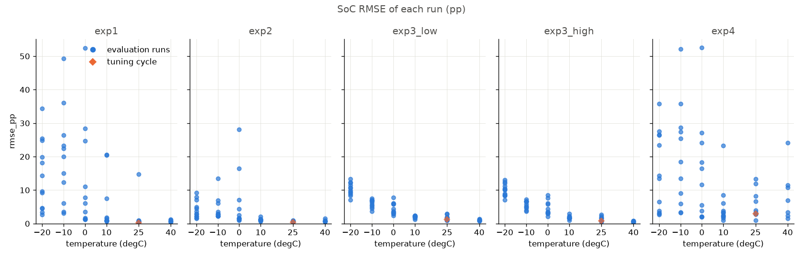
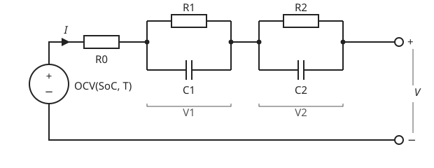

# EKF SoC Estimator

[](https://github.com/aqjole/EKF_SoC_Estimator/actions/workflows/ci.yml)

State-of-charge (SoC) estimation for a Li-ion cell with an equivalent-circuit model and an Extended Kalman Filter (EKF). The Python reference was evaluated offline on the public LG 18650HG2 dataset at six temperatures, from 40 to -20 degC. Its S10 model is 3RC-D0, with a drive-fitted middle branch and v1.0 R1. The embedded C99 library reproduces the v1.0 2RC model.

## Results at a glance

The filter runs four experiments on every drive-cycle run: (1) the correct initial SoC, (2) an initial SoC 20 pp too low, (3) a restart mid-run at 50 % or 90 % SoC when the reference is 70 %, and (4) a +0.2 A current-sensor offset. Errors are SoC RMSE in percentage points (pp) of SoC.

3RC-D0 passed all six S10 guards. It lowered experiment-1 mean SoC RMSE from 2.00 to 0.98 pp across the 23 standard runs and lowered the worst run from 6.25 to 2.39 pp. The 40 Mix runs supplied the calibration data and share drive segments with the standard suite. [S10 results](docs/results.md#s10--drive-fitted-third-branch-with-v10-r1)

The historical S7 comparison shows experiment 1 per temperature for v1.0 2RC and 2RC-I (R1 depends on current).

<!-- results:summary_exp1:begin -->

**Experiment 1**

SoC RMSE with the correct initial SoC. The mean decides the verdict (docs/decisions.md 1.29); the median and the number of runs whose RMSE is lower with 2RC-I show how the change spreads over the runs.

| T (degC) | evaluation runs | mean 2RC (pp) | mean 2RC-I (pp) | mean change (pp) | median 2RC (pp) | median 2RC-I (pp) | runs lower with 2RC-I |
|---|---|---|---|---|---|---|---|
| 40 | 7 | 0.79 | 0.74 | -0.04 | 0.73 | 0.72 | 6 of 7 |
| 25 | 10 | 0.87 | 0.86 | -0.01 | 0.87 | 0.87 | 7 of 10 |
| 10 | 11 | 1.18 | 1.21 | +0.03 | 1.14 | 1.11 | 9 of 11 |
| 0 | 11 | 2.04 | 1.74 | -0.29 | 1.87 | 1.66 | 10 of 11 |
| -10 | 11 | 3.43 | 3.21 | -0.22 | 2.83 | 3.00 | 9 of 11 |
| -20 | 12 | 3.70 | 3.24 | -0.46 | 3.00 | 2.99 | 8 of 12 |

<!-- results:summary_exp1:end -->

The reference SoC is itself coulomb counting, so with a correct start and an exact current sensor plain coulomb counting is near-perfect here (0.03 to 0.06 pp). The EKF earns its place when that fails: in experiments 2 to 4, and under a 5 % capacity error, where from 40 to 10 degC the EKF stays at 0.6 to 1.4 pp while coulomb counting rises to 2.3 to 2.8 pp (`results/sensitivity.md`).

The C port (v1.0 2RC model) against the Python reference, experiment 1 on all 63 runs:

<!-- results:summary_equivalence:begin -->

**Result**

| build | threshold (pp) | max \|delta SoC\| (pp) | worst run | largest RMS (pp) | result |
|---|---|---|---|---|---|
| float | 0.1 | 1.85e-02 | HWFET at -20 degC (610) | 6.00e-03 | PASS |
| double | 0.001 | 5.00e-09 | HWFET at -20 degC (610) | 2.89e-09 | PASS |

<!-- results:summary_equivalence:end -->



*Per-run SoC RMSE of the v1.0 2RC filter in all four experiments (experiment 3 split into its low and high start).*

On a Cortex-M4F in float32 the library takes 19,388 B of flash, 17,432 B of it the const parameter tables, no .data or .bss, and 60 B of state per filter, owned by the caller; it needs no double-precision helpers (`results/c_footprint.md`). All tables and plots of every stage are in [`docs/results.md`](docs/results.md).

## Claims

1. **The EKF recovers from a wrong initial SoC and keeps a current-sensor offset bounded, where plain coulomb counting does not.** This holds in nearly every run at 40, 25, 10 and 0 degC. At -10 and -20 degC it holds only in part: in many cold runs the error does not settle inside the +-2 pp band before the end of the run ("not reached"), and some cold runs end several pp off.
   Evidence: the convergence tables of experiments 2 and 3 (their `reached` rows count the runs per temperature) and the end-of-window errors of experiment 4, where coulomb counting drifts with the offset and the EKF does not ([S2 results](docs/results.md#s2-ekf-experiments)).
2. **The float32 C port reproduces the Python reference to within 0.1 pp of SoC.**
   Evidence: `results/equivalence.md` runs the C filter and the Python filter on every evaluation run and the tuning cycle and compares the SoC row by row; the worst case is in the [C port equivalence](docs/results.md#s3-c-port-equivalence) table.

## Overview

<p align="center"></p>

**Model.** In v1.0, the cell is an open-circuit voltage OCV(SoC, T) in series with an ohmic resistance R0 and two RC branches, a fast one (R1, C1) and a slow one (R2, C2). The current I is positive on discharge. Every parameter is a table over temperature and SoC, read with clamped bilinear interpolation. The OCV comes from the C/20 discharge, corrected onto the HPPC rest voltages; R0 and the RC branches come from the HPPC pulses and rests (`docs/decisions.md` 1.1, 1.2, 1.12). The 3RC-D0 model adds a 45 s middle branch and fits R3 and a scale on R2 on the 40 Mix runs.

**Filter.** The 2RC state is x = [SoC, V1, V2]. The 3RC-D0 state adds V3. The input is the measured current, the measurement is the terminal voltage, and the measured cell temperature selects the table values. Each sample runs a predict step and an update step. The noise settings were tuned once, on one drive cycle (Mix 1 at 25 degC), and frozen (`docs/decisions.md` 1.3, 1.15). When an update pushes SoC outside [0, 1], the whole state is projected onto the bound along the covariance, not truncated (`docs/decisions.md` 1.16).

**Reference SoC.** The reference is coulomb counting on the cycler's own Ah counter from the full charge at the start of each test. Q_ref is the 25 degC C/20 discharge capacity, one value for every temperature (`docs/decisions.md` 1.6, `docs/model.md` C13). The plain coulomb-counting baseline integrates the logged current instead, as a BMS would.

**C port.** `c/` holds a C99 library with the same equations in the same operation order. It uses no dynamic allocation, no mutable globals and no file I/O. `ekf_real_t` is `float` by default and `double` on request.

The two model equations, with `a_i = exp(-dt / tau_i)` and the current held over each step:

- RC branches: `V_i(k) = a_i V_i(k-1) + R_i (1 - a_i) I(k-1)`
- terminal voltage: subtract the branch voltages and `R0(SoC, T) I` from `OCV(SoC, T)`

The full equations and conventions are in [`docs/model.md`](docs/model.md). Experiment protocols and outcomes are in [`docs/decisions.md`](docs/decisions.md).

## What was tried after v1.0

- **S5, sensitivity and an Octave port.** A 5 % error in the filter's capacity, a 1 Hz sample rate, and a GNU Octave port checked against Python like the C port. From 40 to 10 degC the EKF tolerates the capacity error far better than coulomb counting, but not in the cold; the Octave port matches Python to within 1e-11 pp. [Results](docs/results.md#s5-sensitivity)
- **S6, a third RC branch: negative result.** Fitted twice, each time under rules fixed before the fit; both fits made the voltage error on US06 (the most aggressive standard drive cycle) worse at most temperatures, so the 2RC model stays. [Results](docs/results.md#s6-a-third-rc-branch-negative-result)
- **S7, R1 that depends on the current: adopted.** The 2RC-I model lowers the SoC error in the cold and is adopted in the Python reference; it makes US06, the cycle with the highest currents, worse from 10 degC down. [Results](docs/results.md#s7-r1-that-depends-on-current-adopted)
- **S8, R1 by the sign of the current and at low current: three negative results.** Two ways to read R1 under regen (the charging current of regenerative braking) and one low-current R1 fitted on data outside the evaluation set, to undo that US06 regression; each fixed US06 in part but broke guards on other cycles (limits, fixed in advance, on how much any run or cycle may get worse), so 2RC-I stays and the stage is closed. [Results](docs/results.md#s8-r1-by-the-sign-of-the-current-and-at-low-current-three-negative-results)
- **S9, slow-branch resistances fitted on drive data.** 3RC-D lowered open-loop voltage RMSE and experiment-1 mean SoC RMSE at all six temperatures on the standard cycles. The worst-run guard rejected it after US06 at -10 degC rose from 6.25 to 6.40 pp. [Results](docs/results.md#s9-slow-branch-resistances-fitted-on-drive-data)
- **S10, drive-fitted third branch with v1.0 R1.** 3RC-D0 improved experiment-1 SoC RMSE on every standard run versus 2RC-I. The unfitted S9 R1 substitution scored better on US06 and had a higher overall mean. [Comparison](results/model_compare_3rcd0.md)
- **S11 step A, noise settings and initial branch covariance.** A 945-point search on the 40 Mix runs cut its calibration objective from 2.92 to 1.10 pp, but the chosen settings failed six of eight adoption guards: a 5 mV prior on the branch voltages forgets a rested wrong start within a second and collapses a start under load, and the -20 degC runs get worse. The S2 settings stay. [Comparison](results/model_compare_3rcd0n.md) · [Search](results/tuning_3rcd0.md)
- **S11 step B, regen rows at the 4.2 V limit.** Every run meets regen rows held at the cycler's 4.2 V limit near full charge, and the adopted model's cold SoC error moves 3 to 5 pp per run across them. Skipping the update there fails a fixed guard, and a regen resistance term does not move the SoC, so S11 adopts nothing. [Diagnostic](results/regen_limit.md)

## Dataset

LG 18650HG2 Li-ion Battery Data (P. Kollmeyer, M. Naguib and M. Skells, McMaster University, Mendeley Data, DOI [10.17632/b5mj79w5w9.2](https://doi.org/10.17632/b5mj79w5w9.2)): one new 18650 cell tested at six temperatures. The C/20 discharge gives the OCV, the HPPC test gives the resistances and time constants, and 62 drive-cycle runs (UDDS, HWFET, LA92, US06 and eight mixes of them) are the evaluation set. Run selection and the measured capacities are in [`docs/results.md`](docs/results.md#dataset).

## How to run

Requirements: Python 3.12, CMake and a C99 compiler. `make all` also runs `make arm`, which needs the Arm GNU Toolchain, and `make octave`, which needs GNU Octave and is slow.

```sh
python3.12 -m venv .venv
.venv/bin/pip install -r requirements.txt
make data        # download the raw .mat files into data/raw/ and verify their sha256
make all         # every stage, in order, then refresh the copied tables
make readme-check  # fail if README.md or docs/results.md is out of sync with results/
.venv/bin/python -m pytest python/tests -q   # unit tests; those needing the raw data skip without it
```

Every target, what it writes and the extra tools some need (the Arm toolchain, Octave) are listed in [`docs/results.md`](docs/results.md#how-to-run-every-target). To reproduce S9 using the earlier outputs, run `make fit-3rcd` and then `make ekf-3rcd`. Run `make accuracy` for the S10 fit, evaluation and separate diagnosis.

Run `make ekf-3rcd0n` to reproduce the S11 step A comparison from the saved candidate settings; `make tune-3rcd0` repeats the search itself (outside `make all`, needs a host C compiler).

## Limitations

- A personal project, validated offline on public data from one new cell, and only within the tested temperature range.
- Not run on target hardware: the C library is cross-compiled only and not checked against MISRA C or ISO 26262. No SOH or SOP estimation, no Simulink model.
- The model has no hysteresis, no ageing or capacity fade, and takes coulombic efficiency as 1, although the C/20 charge put back 0.98 to 1.07 times the discharge Ah (unexplained). The OCV is the C/20 discharge branch.
- The cell aged over the campaign, which ran 25, 40, 10, 0, -10 and -20 degC in that order, and lost capacity inside the 25 degC block too; one Q_ref is used at every temperature (`results/capacity.md`).
- The reference SoC is itself coulomb counting, on the cycler's Ah counter, so the coulomb-counting baseline on the logged current agrees with it closely by construction. With the cycler's stated accuracy of 0.1 % of full scale, a real current-sensor offset in the data would not show.
- The noise settings were tuned on one cycle at one temperature, and the evaluation runs share segments with it, because the mixes are built from segments of the standard cycles (`docs/decisions.md` 1.11). S7 and S8 compared models on the same 62 runs that every stage since S2 has looked at, so those comparisons are on a repeatedly inspected set (1.32).
- S9 and S10 used 23 previously inspected standard runs for regression checks. They share segments with the 40 Mix runs used for calibration.
- Errors grow in the cold: at -10 and -20 degC many runs of experiments 2 and 3 never settle inside the 2 pp band. The cycler also caps the cold currents, so the cold drive cycles are lighter loads than the warm ones. With the current offset of experiment 4, four cold runs (Mix 8 at -10 and -20 degC, HWFET and Mix 4 at -20 degC) have a larger SoC RMSE than coulomb counting, and US06 at -10 degC ends with a slightly larger error (`results/ekf_results.csv`).
- In the cold the SoC estimate moves by about 3 to 5 pp per run across the regen rows the cycler holds at 4.2 V near full charge; S11 found no change that removes this within the adoption guards.
- The S7 2RC-I model held R1 flat below its smallest pulse current and made US06 worse from 10 degC down. The S10 experiment replaces its current-axis lookup with v1.0 R1 and refits the slow branches.

The full list, with the fit and OCV assumptions, is in [`docs/results.md`](docs/results.md#limitations-in-full).

## Reproducibility

Every result table in this README and in `docs/results.md` sits between `<!-- results:<key>:begin -->` and `<!-- results:<key>:end -->` markers and is copied from a file in `results/` by `python/update_readme.py`. Each of those files is written by a script in this repository. `make all` reproduces them from the raw data, and `make readme-check` and CI fail when the documents and `results/` disagree.

## Citation and licence

The code is under the MIT licence (`LICENSE`).

The dataset is under CC BY 4.0. The excerpts committed as test fixtures, in `python/tests/fixtures/` and `c/tests/fixtures/`, are data from it: they carry the dataset's licence and attribution, not the MIT licence. Each fixtures folder has a README with its source.

Dataset citation: P. Kollmeyer, M. Naguib, M. Skells, "LG 18650HG2 Li-ion Battery Data", McMaster University, Mendeley Data, version 2, 2020. DOI [10.17632/b5mj79w5w9.2](https://doi.org/10.17632/b5mj79w5w9.2).
