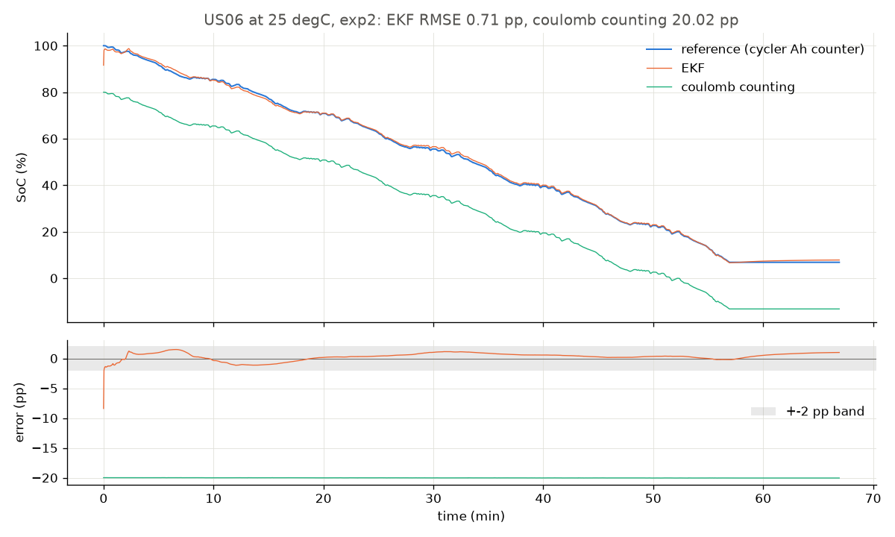
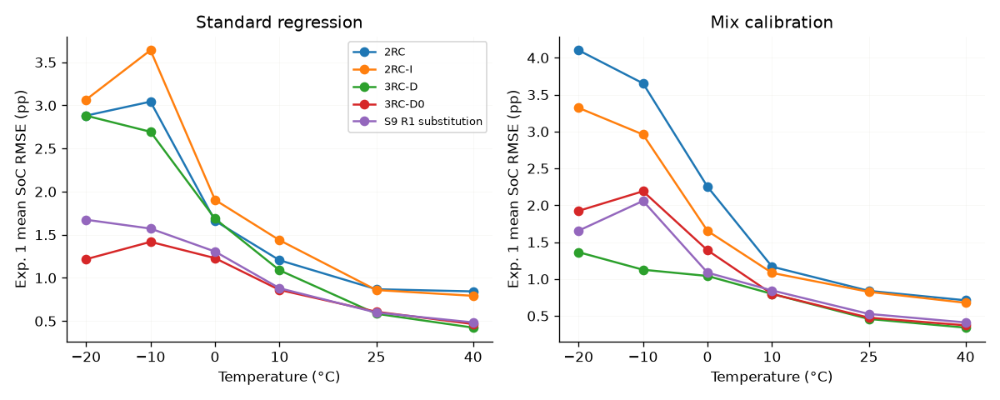
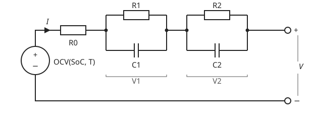

# EKF SoC Estimator

[](https://github.com/aqjole/EKF_SoC_Estimator/actions/workflows/ci.yml)

State-of-charge (SoC) estimation for a Li-ion cell: an equivalent-circuit model identified from test data, an Extended Kalman Filter (EKF) that corrects current integration with the measured cell voltage, and a C99 port of the filter for a microcontroller. Everything is validated offline on the public LG 18650HG2 dataset: one cell, 63 drive-cycle runs, six temperatures from 40 to -20 °C.

The C library is unit-tested, cross-compiled for a Cortex-M4 and checked against the Python reference sample by sample. It has not run on a board yet; that is the next step.

## Key results

Errors are the RMSE of the SoC estimate in percentage points of SoC (pp).

- **Accuracy.** Started at the correct SoC, the final model has a mean error of 0.98 pp over the 23 standard drive-cycle runs (UDDS, HWFET, LA92 and US06), down from 1.79 pp for the first model. It is 0.46 and 0.61 pp at 40 and 25 °C, and 1.42 and 1.22 pp at -10 and -20 °C.
- **Robustness.** With a start value 20 pp wrong, or a 0.2 A offset on the current sensor, plain current integration (coulomb counting) is off by 20 pp and 7.8 pp on average. The EKF's mean error over the 63 runs is between 1.5 and 4.7 pp.
- **Embedded port.** The float32 C library matches the Python reference within 0.02 pp of SoC in 378 replayed cases. On a Cortex-M4 it takes 21,888 B of flash and 92 B of state per cell, with no heap, no mutable globals and no double-precision library calls.
- **Known weak point.** In the cold a wrong start can get worse before the filter recovers: in 30 of 189 wrong-start cases the error first grows past 25 pp, all of them at 0 °C and below. From a start 20 pp too low the final model's mean error (4.69 pp) is also higher than the first model's (2.84 pp). The attempts to fix this failed their acceptance rules and are reported as negative results.
- **Reproducible.** Every result table is copied by a script from a file in [`results/`](results/README.md), and CI fails when a copied table and its file disagree. The numbers in the text are taken from the same files.

### The EKF against coulomb counting

Each drive-cycle run is replayed four ways: (1) from the correct SoC, (2) from a SoC 20 pp too low, (3) restarted mid-run at 50 % or 90 % when the true SoC is 70 %, and (4) with a +0.2 A offset on the measured current. "2RC" is the first model and "3RC-D0" the final one; both are explained below.

<!-- results:headline_experiments:begin -->

**Coulomb counting and the two main filters**

Mean SoC RMSE in pp over all 63 runs of each experiment. Coulomb counting integrates the current the filter sees, from the filter's start value. 2RC is the first model (the v1.0 baseline) and 3RC-D0 the final one (the deployment model); the 63 runs include the 40 mixed-cycle (Mix) runs 3RC-D0 is fitted on, so its means here are partly in-sample.

| Estimator | Exp 1, correct start | Exp 2, start 20 pp low | Exp 3, restart at 50 % | Exp 3, restart at 90 % | Exp 4, current offset |
|---|---|---|---|---|---|
| Coulomb counting | 0.04 | 20.03 | 20.02 | 19.98 | 7.80 |
| EKF, 2RC | 2.10 | 2.84 | 4.21 | 3.86 | 2.31 |
| EKF, 3RC-D0 | 1.17 | 4.69 | 2.37 | 1.78 | 1.50 |

<!-- results:headline_experiments:end -->

Coulomb counting looks perfect in experiment 1 only because the reference SoC is itself the test bench's Ah counter: with an exact start and an exact sensor there is nothing to correct. The filter earns its place in the other columns. The same holds for a wrong capacity: with a 5 % capacity error, from 40 to 10 °C the first filter stays at 0.6 to 1.4 pp while coulomb counting rises to 2.3 to 2.8 pp ([sensitivity](docs/results.md#s5-sensitivity)).



*US06 at 25 °C, started 20 pp too low (first model). The EKF pulls the estimate back to the reference; coulomb counting keeps the 20 pp error for the whole run.*

### Accuracy by temperature

<!-- results:headline_temperature:begin -->

**The two main filters by temperature**

Experiment-1 mean SoC RMSE in pp on the 23 standard runs (UDDS, HWFET, LA92 and US06). No table of either filter is fitted on these runs, but every stage has inspected them and the final model was selected by its results on them: they are a regression set, not unseen data.

| Estimator | 40 degC | 25 degC | 10 degC | 0 degC | -10 degC | -20 degC | All 23 runs |
|---|---|---|---|---|---|---|---|
| EKF, 2RC | 0.84 | 0.87 | 1.20 | 1.66 | 3.04 | 2.88 | 1.79 |
| EKF, 3RC-D0 | 0.46 | 0.61 | 0.86 | 1.23 | 1.42 | 1.22 | 0.98 |

<!-- results:headline_temperature:end -->

The final model is fitted partly on the 40 mixed-cycle runs, so the 23 standard runs are the fairer score. They are not unseen data either: the final model was selected by its results on them, and the mixed cycles are built from segments of the standard ones. Only a second cell would give a truly independent test.



*Experiment-1 error per temperature: the standard runs on the left, the mixed-cycle runs used for fitting on the right. Blue is the first model (2RC) and red the final one (3RC-D0). Orange is the intermediate 2RC-I, green a rejected variant (3RC-D) and purple a diagnostic variant.*

## What the project covers

- **Data pipeline.** A loader for the dataset's 206 `.mat` files with an inventory and consistency checks; the raw data is downloaded and checksum-verified, never committed.
- **Model identification.** The open-circuit voltage from a C/20 discharge, and the resistances and time constants from pulse tests (HPPC), as tables over temperature and SoC. The final model's third branch is fitted on the mixed drive cycles.
- **The filter in Python.** A plain per-sample EKF with three or four states, written to be read line by line next to the equations in [`docs/model.md`](docs/model.md).
- **Evaluation.** Four experiments on 63 runs against coulomb counting, plus sensitivity to a capacity error and to a 1 Hz sample rate.
- **A C99 library.** Float32, no dynamic allocation, unit tests, sanitizer builds, a Cortex-M4 cross-build with a size report, and an equivalence check against Python on every run.
- **An Octave port** of the first filter, checked against Python on experiment 1 of every run (within 1e-11 pp).
- **A decision log.** Each experiment's acceptance rule was written down before the experiment ran ([`docs/decisions.md`](docs/decisions.md)), and the ideas that failed are kept with their numbers.

## How it works

<p align="center"></p>

**Model.** The cell is an open-circuit voltage OCV(SoC, T) in series with an ohmic resistance R0 and RC branches that describe how the voltage relaxes after a load change. Every parameter is a table over temperature and SoC, read with clamped bilinear interpolation. With the current I positive on discharge and held over each step, and `a_i = exp(-dt / tau_i)`:

- RC branches: `V_i(k) = a_i V_i(k-1) + R_i (1 - a_i) I(k-1)`
- terminal voltage: `V = OCV(SoC, T) - R0(SoC, T) I - sum of V_i`

The first model (2RC, in the figure) has two branches, a fast and a slow one. The final model (3RC-D0) adds a third branch between them, with a 45 s time constant, fitted on drive-cycle data.

**Filter.** The state is the SoC and the branch voltages, so three states for 2RC and four for 3RC-D0. The input is the measured current, the measurement is the terminal voltage, and the measured cell temperature selects the table values. Each sample runs a predict step and an update step. The noise settings were tuned once, on one drive cycle at 25 °C, and then frozen. When an update pushes the SoC outside [0, 1], the whole state is projected onto the bound along the covariance instead of being truncated.

**Reference.** The reference SoC is the test bench's own Ah counter, counted from the full charge at the start of each test. The coulomb-counting baseline integrates the logged current instead, as a BMS would.

The full equations and conventions are in [`docs/model.md`](docs/model.md).

## From the first model to the final one

Experiment-1 mean SoC RMSE in pp, from [`results/summary.md`](results/summary.md):

| Model | What changed | All 63 runs | 23 standard runs | Outcome |
|---|---|---|---|---|
| 2RC | two RC branches (fast and slow); OCV from the C/20 discharge, resistances and time constants from the pulse tests | 2.10 | 1.79 | the first release; still the default C build |
| 2RC-I | the fast-branch resistance R1 also depends on the current | 1.92 | 2.00 | a lower mean in the cold over all runs, but worse on US06, the highest-current cycle; replaced later |
| 3RC-D0 | a third branch with a 45 s time constant and a rescaled slow branch, both fitted on the mixed drive cycles; R1 as in 2RC | 1.17 | 0.98 | the final model, also ported to C |

Not adopted, each for failing an acceptance rule fixed before the run:

- A third branch identified from the pulse tests alone (two fits): the model's voltage error without the filter (open loop) on US06 at 25 °C rose from 29.79 mV to 46.79 and 39.70 mV.
- Three more variants of the current-dependent R1: each repaired part of the US06 regression and made other runs worse by more than the rule allowed.
- The third branch combined with the current-dependent R1: a lower mean, but the worst run got worse.
- Retuned noise settings from a 945-point search: better on the tuning objective, worse at -20 °C and on mid-run restarts.
- A smaller initial covariance for a start at rest: the -20 °C wrong-start error fell from 12.45 to 2.61 pp, but two rules failed on the cold standard runs.

The stage-by-stage account is in [`docs/results.md`](docs/results.md#stage-overview), and every model side by side in the [scoreboard](docs/results.md#scoreboard).

## C library

```c
ekf_status_t ekf_init(ekf_t *e, const ekf_cfg_t *cfg, ekf_real_t soc0);
ekf_status_t ekf_step(ekf_t *e, ekf_real_t i_a, ekf_real_t v_v, ekf_real_t t_degc, ekf_real_t dt_s);
ekf_real_t   ekf_get_soc(const ekf_t *e);
```

`c/` holds the same equations in the same operation order as the Python filter. The caller owns one `ekf_t` per cell; the library allocates nothing, keeps no state of its own and does no file I/O. `ekf_real_t` is `float` by default and `double` on request. The default build is the 2RC filter; `-DEKF_USE_3RCD0=ON` builds the four-state 3RC-D0 filter.

The 3RC-D0 build against the Python reference on all 63 runs, in six cases per run (the four experiments, with experiment 3 split into its low, high and reference starts): 378 cases. The number in brackets is the dataset's test number.

<!-- results:summary_equivalence_3rcd0:begin -->

**Result**

| build | threshold (pp) | max \|delta SoC\| (pp) | worst run | largest RMS (pp) | result |
|---|---|---|---|---|---|
| float | 0.1 | 1.94e-02 | Mix 4, exp2 at 0 degC (590) | 3.65e-03 | PASS |
| double | 0.001 | 5.05e-09 | Mix 1, exp3_ref at -10 degC (601) | 2.91e-09 | PASS |

<!-- results:summary_equivalence_3rcd0:end -->

On a Cortex-M4 in float32 the 3RC-D0 build takes 21,888 B of flash, 19,860 B of it the constant parameter tables, and 92 B of state per filter. Its largest single function frame is 376 B of stack and it needs no double-precision helpers (`results/s11/c_footprint_3rcd0.md`). The 2RC build takes 19,388 B and 60 B (`results/s3/c_footprint.md`). More in [C port](docs/results.md#c-port).

## Repository map

| Path | What is there |
|---|---|
| `python/ekfsoc/` | the library: loader, OCV and pulse-test fits, model, EKF, metrics, plots |
| `python/*.py` | the scripts behind the `make` targets and their helpers: `fit_*` fit a model, `run_all` and `compare_*` run the experiments, `diagnose_*` and `sensitivity` are diagnostics, `export_*` write the C tables and test vectors; files named `s8_*` to `s12_*` are helpers of one stage |
| `python/tests/` | the pytest suite; tests that need the raw data skip without it |
| `c/` | the C99 library (`include/ekf.h`, `src/ekf.c`), Unity tests, fixtures and the Cortex-M4 toolchain file |
| `octave/` | the Octave port |
| `docs/model.md` | equations and conventions |
| `docs/decisions.md` | the decision log: what was decided, why, and each outcome |
| `docs/results.md` | every result table and plot, stage by stage |
| `results/` | generated tables and plots, one folder per stage (`s0` to `s12`), with an [index](results/README.md) |
| `data/` | the download script and checksums |

To read the code, start with [`python/ekfsoc/ekf.py`](python/ekfsoc/ekf.py) (the filter, about 250 lines), [`python/ekfsoc/model.py`](python/ekfsoc/model.py) (the cell model) and [`c/src/ekf.c`](c/src/ekf.c) (the C port).

## How to run

Requirements: Python 3.12, CMake and a C99 compiler. `make all` also runs `make arm`, which needs the Arm GNU Toolchain, and `make octave`, which needs GNU Octave and is slow.

```sh
python3.12 -m venv .venv
.venv/bin/pip install -r requirements.txt
make data        # download the raw .mat files into data/raw/ and verify their sha256
make all         # every stage, in order, then refresh the copied tables
make readme-check  # fail if README.md or docs/results.md is out of sync with results/
.venv/bin/python -m pytest python/tests -q   # unit tests; those needing the raw data skip without it
```

Every target, what it writes and the tools it needs are listed in [`docs/results.md`](docs/results.md#how-to-run-every-target).

## Limitations

- A personal project, validated offline on public data from one new cell, and only within the tested temperature range. No run is unseen data: the tuning and fitting runs share drive segments with the scoring runs.
- Not run on target hardware. The C library is cross-compiled only and not checked against MISRA C or ISO 26262.
- The reference SoC is itself coulomb counting on the test bench's Ah counter, so a real sensor offset in the data would not show.
- Errors grow in the cold. At -20 °C a third of the final model's wrong-start cases (12 of 36) never settle inside a 2 pp band, and the test bench caps the cold currents, so the cold cycles are lighter loads than the warm ones.
- The model has no hysteresis and no ageing, and one capacity value is used at every temperature. There is no SOH or SOP estimation.

The full list is in [`docs/results.md`](docs/results.md#limitations-in-full).

## Dataset

LG 18650HG2 Li-ion Battery Data (P. Kollmeyer, M. Naguib and M. Skells, McMaster University, Mendeley Data, DOI [10.17632/b5mj79w5w9.2](https://doi.org/10.17632/b5mj79w5w9.2)): one new 18650 cell tested at six temperatures. The C/20 discharge gives the OCV, the HPPC pulse test gives the resistances and time constants, and the drive cycles (UDDS, HWFET, LA92, US06 and eight mixes of them) are the 62 evaluation runs plus one tuning run. The final model also fits its third branch on the 40 mixed-cycle runs. Run selection and the measured capacities are in [`docs/results.md`](docs/results.md#dataset).

## Reproducibility

Every result table in this README and in `docs/results.md` sits between `<!-- results:<key>:begin -->` and `<!-- results:<key>:end -->` markers and is copied from a file in `results/` by `python/update_readme.py`. Each of those files is written by a script in this repository. `make all` reproduces them from the raw data, and `make readme-check` and CI fail when the documents and `results/` disagree.

## Citation and licence

The code is under the MIT licence (`LICENSE`).

The dataset is under CC BY 4.0. The excerpts committed as test fixtures, in `python/tests/fixtures/` and `c/tests/fixtures/`, are data from it: they carry the dataset's licence and attribution, not the MIT licence. Each fixtures folder has a README with its source.

Dataset citation: P. Kollmeyer, M. Naguib, M. Skells, "LG 18650HG2 Li-ion Battery Data", McMaster University, Mendeley Data, version 2, 2020. DOI [10.17632/b5mj79w5w9.2](https://doi.org/10.17632/b5mj79w5w9.2).
